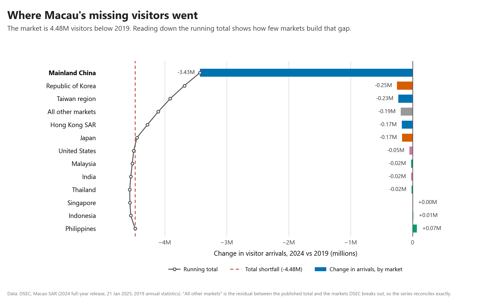
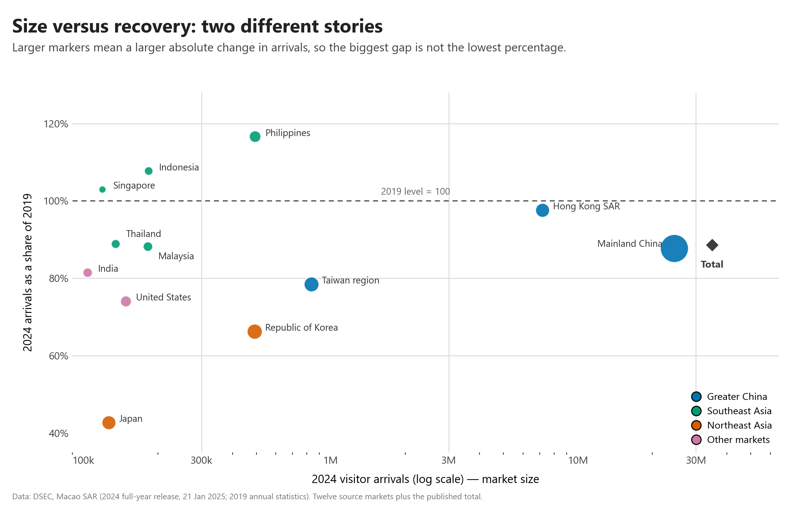

# Who came back to Macau?

Post-pandemic recovery of visitor arrivals by source market, 2019 vs 2024.

## The research question

Macau welcomed **34.9 million visitors in 2024** — its best year since the pandemic,
yet still only **88.6% of the 2019 record of 39.4 million**. The headline number
hides the more useful question, which this project answers:

> **Which source markets actually came back, how much of the remaining
> 4.48-million-visitor gap does each one account for, and are the visitors who
> return the same kind of visitors Macau used to attract?**

The analysis compares 2024 with 2019 on an *index* (2024 as a percentage of 2019)
rather than on raw counts, because the question is not "how many visitors came"
but "how much of the pre-pandemic market returned". Indexing puts a 24.5-million
market and a 0.1-million market on one comparable scale.

## Key findings

- **The recovery is narrow, not broad.** Only three of the twelve source markets
  DSEC reports individually exceeded their 2019 arrivals: the **Philippines
  (116.6%)**, **Indonesia (107.7%)** and **Singapore (103.0%)**. Hong Kong SAR,
  the second-largest market, is essentially back at **97.6%**.
- **One market explains most of the remaining gap.** Mainland China is at
  **87.7%** of 2019 — a shortfall of **3.43 million visitors**, which is
  **77% of Macau's entire 4.48-million gap**, because that market alone supplies
  **70% of all arrivals**. An index near 90% for the largest market is therefore
  not a mild shortfall; it is the shortfall.
- **The markets furthest behind are the diversification targets.** Japan is at
  **42.7%** (the largest relative gap), the Republic of Korea at **66.2%**, the
  United States at **74.0%** and Taiwan region at **78.5%** — the long-haul and
  Northeast Asian markets that a diversification strategy would want to grow.
- **The visitors who returned increasingly come for the day.** Same-day visitors
  are fully back (**101.4%** of 2019) and now make up **54.1%** of all arrivals,
  up from **47.3%**. Overnight guests — the visitors most likely to stay in
  hotels, eat in restaurants and spend across two days — are still **23% below**
  2019 (**77.2%**). Volume recovered faster than depth.






## Dataset

| | |
|---|---|
| **Source** | Statistics and Census Service (DSEC), Macao SAR |
| **Arrivals by market** | "Visitor arrivals for December and the whole year of 2024", news release, 21 January 2025 — <https://www.gcs.gov.mo/news/detail/en/N25AUB2Zwi> |
| **2019 baseline** | DSEC annual visitor arrival statistics for 2019 |
| **Stay type** | DSEC visitor arrival statistics, same-day vs overnight breakdown, 2019 and 2024 |
| **Files in this repository** | `data/visitor_arrivals.csv`, `data/stay_type.csv` |

**Usage permissions.** These are official, aggregate government statistics
published by DSEC for public use. They contain **no personal data**, no
individually identifiable information and no restricted or licensed content, so
they can be redistributed here with attribution. Values were entered by hand from
the two DSEC releases above and **rounded to the nearest thousand**, which is why
the figures here may differ from DSEC's own totals in the last three digits. The
DSEC release is the authoritative source for every number plotted.

**Two notes on scope.** (1) The twelve markets DSEC breaks out individually
account for **98.7%** of 2024 arrivals, so a residual row ("all other markets",
−0.19M) is carried through the analysis so that the contributions reconcile
*exactly* to the published total rather than silently dropping 1.3%. (2) Europe
is not shown because DSEC's 2024 release does not break it out.

No passwords, API keys, personal data or restricted datasets are included in this
repository.

## Methods and tools

- **Python 3** with **pandas** (loading, indexing, aggregation) and
  **matplotlib** (all figures). See `requirements.txt`.
- **Recovery index** — 2024 arrivals ÷ 2019 arrivals × 100 for each market, plus
  the published total.
- **Contribution to the gap** — the absolute change per market, summed
  cumulatively, so the running total lands on the published total change
  (a check that the decomposition is complete).
- **Visual design** — the main figure is a diverging lollipop chart: each market
  is a stem anchored at the 2019 baseline of 100 and ending in a dot at its 2024
  index, sorted so that reading top-to-bottom reproduces the ranking. Colour
  encodes region using colourblind-safe Okabe-Ito hues; every value is printed so
  the chart works in grayscale or print without hover; the stay-type composition
  is a separate facet because it is a share, not a ratio to 2019.
- Each figure carries its own data note, and the eleven numbers quoted in this
  README can be reproduced exactly by running the script.

## How to run the analysis

```bash
# 1. Get the code
git clone https://github.com/terrygao44/data-science-project.git
cd data-science-project

# 2. (Recommended) create an isolated environment
python -m venv .venv
# Windows
.venv\Scripts\activate
# macOS / Linux
source .venv/bin/activate

# 3. Install dependencies
pip install -r requirements.txt

# 4. Run the analysis
python analysis/recovery_analysis.py
```

The script reads the two CSV files in `data/`, prints every statistic quoted
above to the console, and regenerates all three figures into `images/`. It needs
no network access and no credentials of any kind. Expected runtime: a few
seconds.

## Limitation

**The index hides absolute size.** A percentage on a 0.1-million market and a
percentage on a 24.5-million market look equally important when they sit at the
same height on the chart, even though one is worth half a million visitors and
the other is worth tens of millions. The Philippines' 116.6% and Mainland China's
87.7% receive visually equal stems in the first figure, which is exactly the
misreading the callout is there to pre-empt, and `03_scale_vs_recovery.png` plots
size against recovery to expose it. A log-scaled companion is the honest fix, but
no single linear chart can carry both dimensions at once.

Two further blind spots worth stating: annual aggregation hides seasonality and
monthly recovery paths, and nothing here is plotted about visitor *spending* —
DSEC's visitor expenditure survey reports per-capita spending fell 14.6%
year-on-year in 2024 to MOP2,157 even as arrivals rose, a pattern consistent with
the shift towards same-day visits shown above. This analysis describes what
happened, not why: visa policy, route capacity and the regulation of junket
operators are outside its scope.

## Repository structure

```
data-science-project/
├── README.md                     ← this file
├── requirements.txt
├── analysis/
│   └── recovery_analysis.py      ← the whole analysis, one runnable script
├── data/
│   ├── visitor_arrivals.csv      ← arrivals by market, 2019 and 2024
│   └── stay_type.csv             ← same-day vs overnight, 2019 and 2024
└── images/
    ├── 01_recovery_index.png
    ├── 02_shortfall_contribution.png
    └── 03_scale_vs_recovery.png
```
